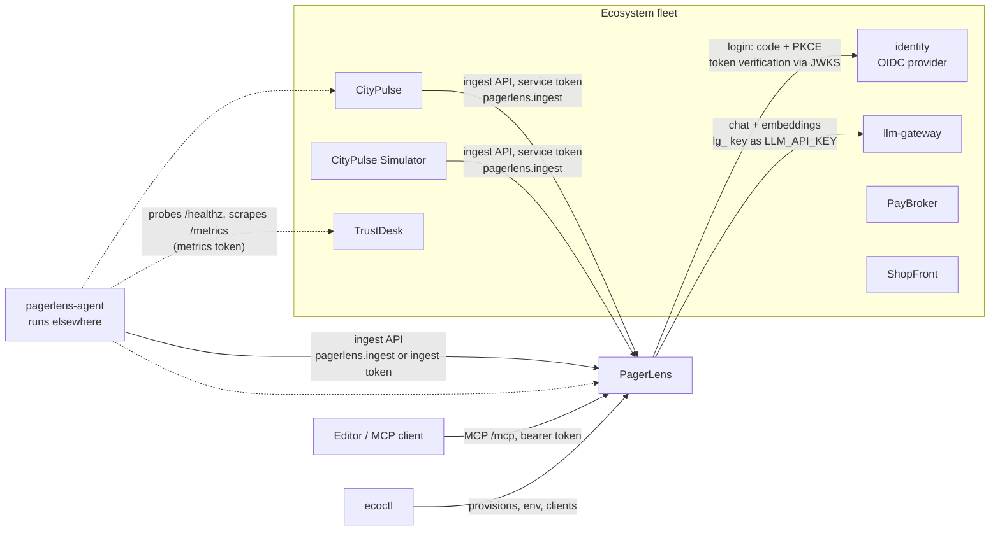
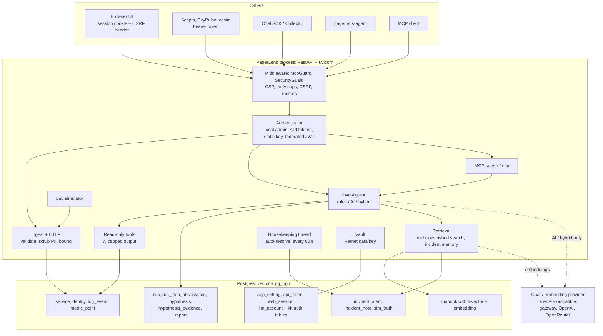

# PagerLens guide

This is the complete guide to PagerLens: what it is for, how it fits the ecosystem, how to install, configure, run and operate it, and what it does not do. It complements the [README](../README.md) (quick start, the investigation method and the MCP client snippets) and [SECURITY.md](../SECURITY.md) (the security model). Statements here were checked against the code in `src/pagerlens/`, the shared kit (`agentpg-kit`, imported as `apgkit`) and the ecosystem manifest (`ecosystem/ecosystem.yaml`). Where something could not be verified it is listed under [Known limitations](#16-known-limitations-and-unverified-claims).

Contents

1. [Purpose and audience](#1-purpose-and-audience)
2. [How PagerLens fits the ecosystem](#2-how-pagerlens-fits-the-ecosystem)
3. [Architecture](#3-architecture)
4. [Install](#4-install)
5. [Configuration reference](#5-configuration-reference)
6. [First run walkthrough](#6-first-run-walkthrough)
7. [Using PagerLens: the web app](#7-using-pagerlens-the-web-app)
8. [Using PagerLens: the REST API](#8-using-pagerlens-the-rest-api)
9. [Using PagerLens: MCP tools](#9-using-pagerlens-mcp-tools)
10. [Getting data in](#10-getting-data-in)
11. [Roles and permissions](#11-roles-and-permissions)
12. [Security notes](#12-security-notes)
13. [Operations](#13-operations)
14. [Testing and development](#14-testing-and-development)
15. [AIDB and AgentPG integration](#15-aidb-and-agentpg-integration)
16. [Known limitations and unverified claims](#16-known-limitations-and-unverified-claims)

Also: [EDB and AgentPG capabilities used by this app](#edb-and-agentpg-capabilities-used-by-this-app) (inside section 15) and [Watching the fleet's databases](#watching-the-fleets-databases-slow-queries) (section 10).

---

## 1. Purpose and audience

PagerLens is an incident-investigation agent. When an alert fires it gathers read-only evidence from telemetry stored in Postgres (deploys, metrics, grouped error logs, service dependencies), ranks the possible causes, and shows for every cause the observations that support it and the ones that refute it. It attaches runbook steps as text for a person to carry out, and it learns from the causes people confirm: a resolved incident is embedded in pgvector and recalled when a similar incident appears. It has no tool that changes a monitored system.

It runs as one small FastAPI service with a web app, a REST API, an MCP server at `/mcp`, and an optional pull agent (`pagerlens-agent`). State lives in Postgres with the `vector` and `pg_trgm` extensions.

Who it is for:

| Audience | What they use it for |
|---|---|
| On-call engineers and responders | See what is degraded, open an incident from an alert, run an investigation, read evidence, record the real cause |
| Platform and SRE teams | Send telemetry (push API, OpenTelemetry, pull agent), tune housekeeping, manage tokens and provider accounts |
| People who work in an editor or terminal | Ask an MCP client (Claude Code, VS Code, Codex, Cursor and others) "why is checkout failing?" against the same data |
| Evaluators of Postgres as an AI platform | The built-in Lab (a fictional shop that breaks on demand) shows the whole loop without connecting anything |

What it is not: a metrics store for long-term retention, a paging or on-call scheduler, or an auto-remediation tool. See [Known limitations](#16-known-limitations-and-unverified-claims).

## 2. How PagerLens fits the ecosystem

PagerLens is one of the apps of the AgentPG showcase ecosystem. Each app runs on its own AgentPG sandbox with its own instance (database). URLs change when a sandbox is recreated, so nothing here hard-codes a live URL: apps learn each other's addresses from environment variables that `ecoctl` fills in.



### 2.1 Interaction by project

| Project | Direction | How | Credentials and scopes | Environment variables (verified) |
|---|---|---|---|---|
| **agentpg-kit** (`apgkit`) | PagerLens imports it | Database access with retry for a waking database, local auth (admin password, sessions, API tokens), federated token verification, the vault, the SSRF guard, metrics, security middleware, migrations, the UI kit served under `/kit/` | none (library) | `PAGERLENS_*` names are built by the kit from the prefix `PAGERLENS` (`_OIDC_ISSUER`, `_OIDC_CLIENT_ID`, `_OIDC_CLIENT_SECRET`, `_LOCAL_LOGIN`, `_API_KEY`, `_ENCRYPTION_KEY`, `_ALLOW_PRIVATE_LLM_URLS`) |
| **identity** | PagerLens relies on it (optional) | Browser login: authorization code with PKCE, state and nonce at `/auth/login` and `/auth/callback`. Services call PagerLens with `client_credentials` tokens. PagerLens verifies tokens locally against the provider's JWKS (algorithm allow-list, issuer, audience, expiry); it does not call identity per request. Sign-out also ends the single sign-on session | Web client id `pagerlens`, redirect `https://<pagerlens>/auth/callback`, roles `admin`, `responder`, `viewer`. Service scopes `pagerlens.ingest`, `pagerlens.read`, `pagerlens.metrics` | `PAGERLENS_OIDC_ISSUER` (federation is off when unset), `PAGERLENS_OIDC_CLIENT_ID` (default `pagerlens`), `PAGERLENS_OIDC_CLIENT_SECRET[_FILE]`, `PAGERLENS_PUBLIC_URL`, `PAGERLENS_LOCAL_LOGIN` |
| **llm-gateway** | PagerLens calls it | OpenAI-style `POST {LLM_BASE_URL}/chat/completions` (with `tools` for the AI methods) and `/embeddings` | The app's own gateway client key (`lg_...`) as `LLM_API_KEY`. This is a gateway key, not an identity token. `ecoctl` creates one client per app with `llm: true`, allows the chat and embedding aliases, and applies rpm and token budgets | `LLM_BASE_URL`, `LLM_API_KEY`, `LLM_CHAT_MODEL`, `EMBEDDING_MODEL`, `EMBEDDING_DIM` (set by `ecoctl` from the `llm:` block of the manifest) |
| **CityPulse** | CityPulse calls PagerLens | Its optional reporter posts to `/api/ingest/services`, `/api/ingest/deploys`, `/api/ingest/metrics` and `/api/ingest/alerts`: services for the ingest gateway, the fleet and each city, with metrics such as fleet health, overload and offline shares | Service token from identity, scope `pagerlens.ingest`, audience `pagerlens` (or a hand-copied `ingest` token as `PAGERLENS_TOKEN` on the CityPulse side) | On CityPulse: `PAGERLENS_URL`, `PAGERLENS_TOKEN`, `CITYPULSE_SERVICE_CLIENT_ID/_SECRET`. On PagerLens: none |
| **CityPulse Simulator** (`cpsim`) | Calls PagerLens in two ways | (1) Self-report of its own health through the same ingest endpoints. (2) "PagerLens workloads": a fictional shop that reports telemetry through `/api/ingest/{services,deploys,logs,metrics,alerts}`, with switchable scenarios (`healthy`, `bad_deploy`, `error_spike`, `latency`, `silence`) | Scope `pagerlens.ingest` (minted from identity) or an ingest token | On the simulator: `PAGERLENS_URL`, `PAGERLENS_TOKEN` and the fleet variables. On PagerLens: none |
| **pagerlens-agent** | Calls PagerLens, and scrapes others | Runs next to what it watches, not on AgentPG. Pushes to the ingest API; probes `/healthz` and scrapes `/metrics` of TrustDesk, CityPulse, the simulator and PagerLens itself | To PagerLens: `ingest` token (`PAGERLENS_TOKEN`) or its own service client, scope `pagerlens.ingest`. To each scrape target: that app's own `metrics` token, named per target with `token_env` | `PAGERLENS_TOKEN` (name configurable), `PAGERLENS_AGENT_OIDC_ISSUER`, `PAGERLENS_AGENT_OIDC_CLIENT_ID`, `PAGERLENS_AGENT_OIDC_CLIENT_SECRET[_FILE]` |
| **TrustDesk** | PagerLens observes it | Only through the agent (probes, `/metrics`). The apps share metric names (`http_requests_total`, `http_request_duration_seconds`, `db_up`, `app_info`, `process_*`), so one agent preset reads them all. TrustDesk uses the same table names as PagerLens: they must not share a database | A TrustDesk `metrics` token for the scrape | none on PagerLens |
| **PayBroker** | No direct call in code | Not wired to PagerLens in the manifest or in PayBroker's source. It can be added as an agent target like any HTTP service. In the manifest the group `risk-team` grants people `viewer` in PagerLens | n/a | none |
| **ShopFront** | No direct call in code | Same as PayBroker: no PagerLens integration in the manifest or its source. It can be an agent target | n/a | none |
| **ecoctl** | Provisions PagerLens | Creates the instance and sandbox (extensions `vector` and `pg_trgm`), registers the identity web client `pagerlens` with its roles and the exposed scopes, creates the gateway client, and injects the environment above. `ecoctl env pagerlens` prints it (secrets masked unless `--reveal`) | Identity client secrets and the gateway key are kept in `ecosystem/.ecosystem/` (git-ignored), never in the manifest | `PAGERLENS_ENCRYPTION_KEY` (generated by `ecoctl`, see `generate:` in the manifest) plus the OIDC and LLM variables |

Manifest facts (`ecosystem/ecosystem.yaml`, app `pagerlens`): `llm: true`, extensions `[vector, pg_trgm]`, `generate: [PAGERLENS_ENCRYPTION_KEY]`, roles `admin`, `responder`, `viewer`, `exposes: [pagerlens.ingest, pagerlens.read, pagerlens.metrics]`. The apps `citypulse` and `cpsim` list `pagerlens: [pagerlens.ingest]` under `calls`; the registered-only app `pagerlens-agent` (`deploy: false`) does too.

Two details worth knowing:

- `ecoctl` does not set `PAGERLENS_PUBLIC_URL`. Without it, PagerLens builds the OIDC callback from the request's own `Host` header, honouring the forwarded protocol (AgentPG terminates TLS in front of the sandbox). Set `PAGERLENS_PUBLIC_URL` if you put another proxy in front.
- The embedding size is fixed when the database is first migrated. The manifest's `llm.embed_dimensions` becomes `EMBEDDING_DIM`; PagerLens' own default is 768. Change it only for a new fleet, or rely on the reconciler described in [section 13](#changing-the-embedding-size).

## 3. Architecture



Components, as implemented in `src/pagerlens/`:

| Module | Role |
|---|---|
| `api.py` | FastAPI app: routes, middleware wiring, static files, lifespan (vault auto-unlock, setup-code announcement, housekeeping thread, MCP session manager) |
| `core.py` | The app's instances of the kit blocks, and the permission model (permissions, role and scope maps) |
| `ingest.py`, `otlp.py`, `scrub.py` | Validated, bounded, PII-scrubbed collection; OTLP/HTTP decoding with a bounded gzip inflate |
| `tools.py` | The registered read-only tools: `service_overview`, `recent_deploys`, `metrics_overview`, `slow_queries`, `error_signatures`, `log_sample`, `find_similar_incidents`, `find_runbooks` |
| `investigator.py`, `investigator_core.py`, `llm_agent.py` | Rules, AI and hybrid investigations; budget, step recorder, tool runner |
| `retrieval.py`, `embeddings.py`, `embedcfg.py`, `migrate.py` | Hybrid runbook search, incident memory, embedding client with an offline hashing fallback, vector-size reconciliation |
| `incidents.py`, `dashboard.py`, `housekeeping.py` | Incident reads and human actions; per-service verdicts and sparklines; retire, bulk resolve, auto-resolve, stale |
| `simulator.py`, `evaluate.py` | The Lab (ten scenarios, five-service shop) and the cold-versus-warm evaluation |
| `slowquery.py` | `db_insights_*` gauges as telemetry: the `slowq_<queryid>` metric names and the agent-side sustained-rise detector |
| `live.py` | Live updates: the `tcn` triggers' notifications, one LISTEN connection, fan-out to server-sent events |
| `hardening.py` | After-migrate hook for the read-only role: masked views for personal data, REVOKE for secrets |
| `accounts.py`, `chat.py`, `llm_http.py`, `netguard.py` | Provider accounts (keys encrypted), chat calls, bounded HTTP, URL guard |
| `mcp_server.py` | The nine MCP tools |
| `agent.py` | `pagerlens-agent`, the pull collector |
| `cli.py` | The `pagerlens` command |
| `migrations/001..005_*.sql` | Plain-SQL schema (005 adds the guarded `tcn` triggers), applied by name; `{{EMBEDDING_DIM}}` is substituted at migration time |

Design choices: plain SQL migrations and no ORM, no queue (investigations are synchronous and bounded), single-tenant data, and the ground truth of simulated incidents in a table (`sim_truth`) that the investigation code never reads.

## 4. Install

Requirements: Python 3.11 or newer, and Docker for the local database. The shared kit must be available: from a sibling checkout `../agentpg-kit` for development (`pyproject.toml` points `[tool.uv.sources]` at it), or from the published release tag (the Dockerfile installs `agentpg-kit` v0.2.5 from GitHub; CI does the same). `pyproject.toml` requires `agentpg-kit>=0.2.5`.

### 4.1 Local development with a throwaway Postgres

```bash
cd pagerlens
cp .env.example .env                 # then set POSTGRES_PASSWORD; .env is git-ignored
python3 -c "import secrets; print(secrets.token_urlsafe(24))"   # a value for POSTGRES_PASSWORD
docker compose up -d db              # pgvector/pgvector:pg17 on 127.0.0.1:5433, volume pgdata
python3 -m venv .venv
.venv/bin/pip install -e ../agentpg-kit -e ".[dev]"
set -a; . ./.env; set +a             # exports DATABASE_URL (it expands POSTGRES_PASSWORD)
.venv/bin/pagerlens migrate          # prints: applied: 001_init.sql, ... ; creates extensions it is allowed to
.venv/bin/pagerlens seed             # demo fleet, 12 runbooks, healthy baseline telemetry
.venv/bin/pagerlens serve            # http://localhost:8000
```

Notes verified in code:

- `pagerlens migrate` applies the SQL files and the kit's auth schema, and is idempotent. `serve` does not migrate; `start` does.
- `seed` loads the five-service demo fleet and 90 minutes of healthy telemetry. It resets existing telemetry (`reset_telemetry` deletes logs, metrics and deploys; incidents and reports are kept).
- On the first `serve`, the one-time setup code is printed to stderr (the banner "PagerLens first-run setup"). It is held in memory only and changes on each restart until setup is complete.
- To throw everything away: `docker compose down -v` deletes the database volume. `make up`, `make down`, `make migrate`, `make seed`, `make serve`, `make lint`, `make test` and `make test-db` wrap these commands (see the [Makefile](../Makefile)).
- Never set `PAGERLENS_ALLOW_ANONYMOUS=true` on anything reachable.

### 4.2 Docker Compose

```bash
cp .env.example .env     # set POSTGRES_PASSWORD
docker compose up        # builds the image and starts db and api
docker compose logs api  # contains the one-time setup code
```

`docker-compose.yml` defines `db` (pgvector pg17, healthcheck on `pg_isready`, host port 127.0.0.1:5433) and `api` (built from the `Dockerfile`, host port 127.0.0.1:8001 mapped to the container's 8000, `AUTO_SEED: "true"`, command `pagerlens start`). The build installs the kit from a GitHub release archive, so it needs network access to GitHub. The compose file is for local development only: the database is bound to localhost and no password is committed.

`pagerlens start` is the container entrypoint (also the image's default `CMD`): connect to the database (retrying with backoff while a scaled-to-zero database wakes), apply migrations, reconcile the embedding size, make sure the runbooks exist, seed the demo fleet if `AUTO_SEED` is true and no service exists, then serve. The image runs as a non-root user and has a `HEALTHCHECK` against `/healthz`.

### 4.3 Deploy through ecoctl (the fleet)

The fleet is provisioned from `ecosystem/ecosystem.yaml` with `ecoctl` (commands: `validate`, `plan`, `apply`, `recreate`, `status`, `env`, `db`, `llm`, `connect`). For PagerLens, the manifest has already declared what it needs.

```bash
cd ecosystem
.venv/bin/ecoctl plan                               # shows what apply would create; changes nothing
.venv/bin/ecoctl apply --only pagerlens --execute   # also pulls in identity and the gateway it depends on
.venv/bin/ecoctl status                             # health, ready, LLM client and its test call
.venv/bin/ecoctl env pagerlens                      # the environment the sandbox is created with (secrets as ***)
.venv/bin/ecoctl llm test pagerlens                 # one tiny chat call with the app's own gateway key
.venv/bin/ecoctl recreate pagerlens                 # new image or environment; the URL changes
```

What `apply` does for PagerLens: an instance named `eco-pagerlens-db` with `vector` and `pg_trgm` enabled, a sandbox `eco-pagerlens` running `ghcr.io/<owner>/pagerlens:<tag>` on port 8000, the generated `PAGERLENS_ENCRYPTION_KEY`, the identity web client and service wiring, and the gateway client with `LLM_*` and `EMBEDDING_*`. (The exact `--only` and flag spelling is defined by `ecoctl --help`; the ecosystem [DEPLOY.md](../../ecosystem/docs/DEPLOY.md) is the reference. This guide only names the commands the manifest and CLI define.) After a recreate, apps that call PagerLens (CityPulse, the simulator) are recreated too so they get the new address, per the manifest's `calls`.

Manual deployment on AgentPG without `ecoctl` is in the README ("Deploy on AgentPG"): a dedicated instance, `agentpg extensions create vector|pg_trgm`, then `agentpg sandbox create pagerlens --image ... --instance <id> --port 8000`. Use a dedicated instance per app: PagerLens and TrustDesk create tables with identical names in `public`.

## 5. Configuration reference

All variables below were checked in `config.py`, `core.py`, `cli.py`, `housekeeping.py`, `agent.py` and the kit. Boolean variables accept `1`, `true`, `yes` or `on` (case-insensitive) through the kit's `env_bool`; `PAGERLENS_ALLOW_ANONYMOUS` additionally goes through `config.py`, which accepts `1`, `true`, `yes`. Variables marked `[_FILE]` can alternatively be supplied as a file: `<NAME>_FILE=/path` (or, where shown, a default path), first line used.

### Server and database

| Variable | Default | Meaning |
|---|---|---|
| `DATABASE_URL`, `DB_EXTERNAL_DSN`, `PSQL_CONNECTION_STRING` | empty | Postgres URI; first one set wins. If none is set, libpq falls back to `PGHOST`, `PGUSER`, `PGPASSWORD`, `PGDATABASE` (linked AgentPG sandboxes provide them). The role must be allowed to use `vector` and `pg_trgm` (or they must exist already) |
| `HOST` | `0.0.0.0` | Bind address of `serve` and `start` |
| `PORT` | `8000` | Port of `serve` and `start` (the image also reads it for its healthcheck) |
| `AUTO_SEED` | unset (false) | With `start`: load the demo fleet if no service exists. `1`, `true`, `yes` |
| `SSL_CERT_FILE` | set in the image | Points psycopg's bundled OpenSSL at the system CA bundle so `sslrootcert=system` works |

### Authentication and secrets

| Variable | Default | Meaning |
|---|---|---|
| `PAGERLENS_ALLOW_ANONYMOUS` | false | `true` disables authentication entirely. Throwaway local demos only |
| `PAGERLENS_API_KEY[_FILE]` | none (file: `/etc/pagerlens/api_key`) | Optional static full-access credential for automation. Prefer API tokens |
| `PAGERLENS_ENCRYPTION_KEY[_FILE]` | none (file: `/etc/pagerlens/encryption_key`) | Platform-managed secret that lets the vault unlock itself after a restart. With single sign-on and no admin password it also lets PagerLens create the vault |
| `PAGERLENS_OIDC_ISSUER` | none | Identity provider URL. Federation is off when unset |
| `PAGERLENS_OIDC_CLIENT_ID` | `pagerlens` | The app's client id at the provider |
| `PAGERLENS_OIDC_CLIENT_SECRET[_FILE]` | none | The app's secret at the provider |
| `PAGERLENS_LOCAL_LOGIN` | true | `false` removes the admin-password login when single sign-on is on (otherwise it remains as a break-glass) |
| `PAGERLENS_PUBLIC_URL` | derived from the request | The URL PagerLens is reached at; used to build `/auth/callback` and the post-logout URL |

### AI providers and embeddings

| Variable | Default | Meaning |
|---|---|---|
| `LLM_BASE_URL` | empty | OpenAI-compatible base URL (for example the gateway's `.../v1`). Defines the `env` account and the embedding provider. Empty means no provider and the offline hashing embedder |
| `LLM_API_KEY[_FILE]` | none (file: `/etc/pagerlens/llm_api_key`) | Key for the environment provider |
| `LLM_CHAT_MODEL` | empty | Chat model of the `env` account; without it the `env` account cannot be used for AI investigations |
| `EMBEDDING_MODEL` | `text-embedding-3-small` | Embedding model name |
| `EMBEDDING_DIM` | `768` | Vector size. The vector columns are created with it on first migration; a later change makes the next start resize and re-embed (section 13) |
| `EMBEDDING_SEND_DIMENSIONS` | true | Send a `dimensions` field with embedding requests. Set `false` for providers that reject it |
| `PAGERLENS_ALLOW_PRIVATE_LLM_URLS` | false | Allow provider base URLs on loopback or private networks (a local model server). Link-local is always blocked. Settings from the environment are trusted and skip this guard |

### Behaviour

| Variable | Default | Meaning |
|---|---|---|
| `PAGERLENS_HOUSEKEEPING` | true | `false` stops this process's background auto-resolve thread. The runtime switch is the `auto_resolve_minutes` setting (0 = off) |

### Runtime settings (stored in the database, not the environment)

| Setting | Default | Range | Meaning |
|---|---|---|---|
| `auto_resolve_minutes` | 30 | 0 to 1440 (0 = off) | How long an untouched open incident's alert must have been quiet and its service healthy before it is auto-resolved |
| `stale_after_minutes` | 60 | 0 or 5 to 43200 (0 = off) | No data for this long marks a service stale |

Both are edited in Settings or through `GET`/`PUT /api/settings/housekeeping` and apply at once.

### pagerlens-agent

| Variable | Default | Meaning |
|---|---|---|
| `PAGERLENS_TOKEN` | none | An `ingest` token. The variable name is `pagerlens.token_env` in the YAML (default `PAGERLENS_TOKEN`) |
| `PAGERLENS_AGENT_OIDC_ISSUER`, `PAGERLENS_AGENT_OIDC_CLIENT_ID`, `PAGERLENS_AGENT_OIDC_CLIENT_SECRET[_FILE]` | none | The agent's own service client; it mints tokens with scope `pagerlens.ingest`. A static token wins when both are set |
| per-target `token_env` | none | The name of a variable holding that target's own `metrics` token. Only the name is in the YAML |

Agent YAML keys (checked in `agent.py`): `pagerlens.url`, `pagerlens.token_env`, `interval_seconds` (minimum 5, default 30), and per target `name`, `tier`, `owner`, `description`, `depends_on`, `probes[]` (`url`, `expect_status` default 200, `timeout` default 10, `token_env`), `scrape[]` (`url`, `timeout`, `token_env`, `mem_limit_mb`; only the Prometheus type with preset `http-standard`), `agentpg[]` (`sandbox_id` like `sbx-1234abcd`, experimental) and `alert` (`after_failures` default 3, `name` default `ServiceDown`, `severity` default `sev2`). See [agent.example.yaml](../agent.example.yaml).

### Development and CI

| Variable | Meaning |
|---|---|
| `POSTGRES_PASSWORD` | Password of the compose database (required by `docker-compose.yml`) |
| `TEST_DATABASE_URL` | Enables the database tests; they skip when it is unset |

## 6. First run walkthrough

1. Start the server (section 4). Find the one-time setup code in the log (`pagerlens serve` stderr, `docker compose logs api`, or `agentpg sandbox logs <sandbox-id>`).
2. Open the app. Before setup it shows "Set up PagerLens". Enter the setup code, choose an admin password of at least 12 characters, repeat it, and press **Create admin password**. You are signed in. Wrong codes are rate limited.
3. If you seeded (`pagerlens seed`, `AUTO_SEED=true`, or compose), the **Dashboard** shows five healthy services of a fictional shop: `web-frontend`, `checkout-api`, `payments-gateway`, `inventory-api`, `search-service`. Otherwise the dashboard is empty until telemetry arrives; the **Lab** tab can load the healthy baseline (**Load healthy baseline**).
4. Open **Lab**, choose a scenario (for example "Bad release breaks checkout") and press **Break it**; confirm the dialog (it replaces the demo telemetry). An alert fires and you land on the new incident.
5. On the incident press **Investigate** with method **Rules (no AI, free)**. Read the hypotheses, open evidence links, read the report and the run viewer.
6. Press **Reveal simulated answer** only after resolving (see section 7.4). Under **Close the loop** choose the real cause and press **Mark resolved**. Break the same scenario again: the new report can show the earlier incident under "Similar past incidents".
7. Under **Settings > Provider accounts** add an AI account if you want the **Rules + AI** or **AI only** methods (section 7.6).
8. Under **Settings > API tokens** create tokens for your telemetry senders (`ingest`) and your MCP clients (`read`), then see the **Connect** tab.

## 7. Using PagerLens: the web app

The navigation tabs are shown according to the signed-in permissions: **Dashboard**, **Incidents**, **Runbooks**, **Lab**, **Database** (administrators), **Settings**, **Connect**. The server enforces access; the UI only hides what a role would be refused. Hash routes: `#dashboard`, `#service/<name>`, `#incidents`, `#incidents/<id>`, `#runbooks`, `#lab`, `#insights`, `#settings`, `#connect`.

### 7.1 Dashboard

One card per service with a verdict: `down`, `degraded`, `stale` (shown as "No data"), `unknown` or `healthy`, the reasons, sparklines for up to the first three of the metrics it reports, last-data age, dependencies, tier and open-incident badge. It refreshes every 10 seconds. The verdict rules (`dashboard.py`):

- `down`: fresh data (newest point within 5 minutes) and `up` at or below 0.5, or `sandbox_running` at or below 0.5.
- `degraded`: fresh data and `db_up` at or below 0.5, or a metric over its limit (`error_rate` 5 or more, `mem_pct` 90 or more, `cpu_pct` 90 or more, `fleet_health_pct` below 85, `overloaded_pct` 5 or more, `offline_pct` 5 or more, `fault_pct` 3 or more, `reject_pct` 5 or more), or an open incident.
- `stale`/`unknown`: a service with data older than the stale limit is stale; one that never reported is unknown.

Filter by status chip or by name. A stale card offers **Retire service** (administrators only). A collapsible "Send your own telemetry" help shows the ingest commands. Clicking a card opens the service page (`#service/<name>`): charts for a chosen window, deploys, recent errors and a **Retire service** panel (administrators only, see 7.7).

### 7.2 Incidents

The list has filters for status (open, investigating, resolved) and service, a checkbox per row, **Resolve selected**, and a "Resolve many incidents" panel (7.7). An incident is opened by an alert (the Lab, the ingest API, the agent or a reporter). An alert joins an existing open incident of the same service when it has the same fingerprint (a hash of the service and the normalized alert name) or, when an embedding is available, a near-identical symptom (cosine similarity above 0.9) within the last 3 hours; otherwise it opens a new one.

Live updates: the incident list and the incident page re-read themselves when an incident or alert changes (Postgres `tcn` row-change notifications delivered as server-sent events by `GET /api/events`, permission `incidents:read`; the stream carries only `{table, op, id}`, never row content, and the page re-reads through the normal API). A typed note, the chosen method and the focus survive the reload. Where the database cannot send changes (the `tcn` extension is missing, no `EventSource`, or the stream is refused) the same pages poll every 20 seconds instead. The listener is one database connection per web process, opened when the first browser subscribes and closed 30 seconds after the last one leaves.

### 7.3 Investigating

On an incident page (needs `incidents:investigate`): pick a **Method**, tick or untick **Use memory of resolved incidents**, press **Investigate** (the button reads **Investigate again** after the first run). The chosen method is remembered in the browser's local storage.

| Method | Meaning | Needs |
|---|---|---|
| Rules (no AI, free) | Deterministic investigator, tool-call budget of 30 | nothing |
| Rules + AI (recommended) | Rules first, then a model drives the same read-only tools (at most 8 rounds, 4 tool calls per round, 12 tool calls, 150 s wall clock, up to two extra model calls to get a final answer); the two are reconciled | a chat account |
| AI only | The model alone, same bounds | a chat account |

The page then shows: **Hypotheses** (rank, title, source badge `rules`/`AI`/`rules + AI`, category, score, a confidence bar, supporting and refuting evidence with links; click `evidence #N` to see the raw observation as untrusted data), charts of the alerting service and its dependencies, the **Report** (Markdown with a **Copy Markdown** button), the **Run viewer** (every step in order: tool, summary, rows, milliseconds; a selector for earlier runs) and the **Notes** section. Reports contain: Most likely cause, Rules vs AI (when applicable), Timeline (UTC), Hypotheses, Other recent deploys considered unrelated, Similar past incidents, Suggested runbooks (manual steps).

The thirteen failure categories and their UI names: Bad deploy, Database saturation, Resource exhaustion, Dependency outage, Traffic spike, Expired certificate, Service down, Sandbox paused, Database unreachable, Ingest overload, Sensor fleet outage, Bad sensor data, Slow query. The hybrid scoring table is in the README.

### 7.4 Closing the loop (memory)

Under **Close the loop** (needs `incidents:write`) choose the **Real cause** (preselected to the top hypothesis), optionally add a note, and press **Mark resolved**. The incident is resolved with that category and re-embedded together with its top error signatures, so it can be recalled later (toast: "Incident resolved and remembered"). For simulated incidents, a resolved incident offers **Reveal simulated answer**, which shows the scenario and true cause and whether the top hypothesis matched. Real incidents have no truth: `GET /api/incidents/{id}/truth` returns `null`.

### 7.5 Runbooks

A read-only list of runbooks (title, category, optional service, body). Thirteen ship with PagerLens (`simulator.RUNBOOKS`): bad release, pool saturation, memory leak, dependency outage, traffic spike, expired certificate, service down, sandbox paused, database unreachable, collection tier overloaded, sensors stopped reporting, sensors sending bad data, slow query regression. They are inserted at startup if missing (never overwritten). Reports attach the best matches found with hybrid search (vector plus full-text, reciprocal rank fusion) as manual steps. There is no UI to add runbooks in this version; they are rows in the `runbook` table.

### 7.6 Lab

Ten scripted scenarios on a fictional five-service shop: `bad_deploy`, `db_pool_exhaustion`, `memory_leak`, `dependency_outage`, `traffic_spike`, `cert_expiry`, `coincident_deploy`, `load_induced_oom`, `deploy_leak`, `slow_query` (a statement in inventory-api's database goes from 12 ms to about 480 ms with no deploy and no saturation; the finding names the query id and both means, see section 10). **Break it** (needs `simulator:run`, administrators only) regenerates 90 minutes of telemetry with the failure starting 20 minutes ago, replacing the demo telemetry, and fires the alert; incidents and reports are kept. **Load healthy baseline** resets to healthy. The same from the CLI: `pagerlens simulate` lists scenarios, `pagerlens simulate <key>` triggers one. Only the newest scenario has live telemetry, and the Lab replaces telemetry of services with the same names, so do not run it on an instance that monitors real services with those names.

### 7.7 Settings

- **Provider accounts** (admin): add OpenAI-compatible accounts (presets: OpenAI, OpenRouter, GLM, Kimi, Anthropic's compatibility endpoint, Custom). Fields: provider, name, base URL (https; plain http only for allowed local servers), API key (stored encrypted, only the last four characters are shown), chat model, embedding model and embedding size. **Test chat** and **Test embeddings** make one tiny real call. **Use for embeddings** makes a saved account the embedder for runbook search, incident memory and alert de-duplication (it probes the provider first; the choice is stored in the database and shown as an "embeddings" badge). The environment provider appears read-only as "Environment (server settings)" and is the default embedder. If the account's size differs from the stored vectors, retrieval stays on text search until a re-embed converts them (section 13). Storing a key requires the vault: set an admin password first. After a restart the vault is locked, so an account embedder is unavailable (text search, nothing is changed in the database) until the administrator signs in.
- **Stale services and recovered incidents** (admin): the two housekeeping numbers (section 5).
- **Security** (admin): set or change the admin password (changing it signs every browser out), create and revoke **API tokens** with scope `read`, `ingest`, `metrics` or `full` (shown once), and unlock the vault after a restart.

Keeping the dashboard clean (all of these resolve with a note and no cause, so nothing is embedded or remembered):

- **Retire a service**: `POST /api/services/{name}/retire` with `{"confirm": "<name>"}`; permission `services:retire` (administrators and `full` tokens). It deletes the service with its metric points, log events, deploys and dependency edges, removes the edge from services that depended on it, and resolves its open incidents as `service retired`; those incidents stay as history under the service's name. Telemetry that arrives later for that name creates the service again. In the UI: type the name on the service page or the stale card.
- **Resolve many incidents**: `POST /api/incidents/bulk-resolve` with `reason`, `confirm: true`, and either `ids` or `all_matching: true` with optional `status` (`open` or `investigating`) and `service`. Limit 5000 per request. Each incident gets `bulk resolved: <reason>` and a note naming who did it.
- **Auto-resolve**: a background pass every 60 seconds in every web process (one at a time across replicas through an advisory lock) resolves an incident with the note `auto-resolved: recovered` only when all hold: status is `open` (never `investigating`), no note, no investigation run of any kind, its newest alert (or its detection) is at least `auto_resolve_minutes` old, and the service reported without a gap over 5 minutes across the whole window with no data point over a dashboard limit. Every condition is re-checked inside the update.
- **Stale services**: described under Dashboard.

### 7.9 Database (administrators)

The **Database** tab (`#insights`, needs `settings:manage`) is the kit's query-insights panel for PagerLens' own database, from `GET /api/insights?order=total|mean|calls&limit=` (`apgkit.insights.insights_payload`): top statements by `queryid` (sortable, filterable; `edb_stat_monitor` buckets, else `pg_stat_statements`), `edb_pg_tuner` recommendations and `query_advisor` index hints. Each part degrades on its own to "Not available on this database" with the reason (a plain Postgres has none of the `edb_*` extensions; the route never returns a 500 for that). Statement text can reveal the workload, so it is behind the admin permission. The same statistics are exported at `/metrics` as `db_insights_available`, `db_insights_top_query_mean_seconds{queryid}`, `db_insights_statement_calls` and `db_insights_tuner_recommendations` (cached 30 s), which is what other PagerLens instances (or this one) can watch, see section 10.

### 7.8 Connect

Shows MCP client configuration snippets for your URL (Claude Code, VS Code, OpenCode, Codex CLI, Cursor, Windsurf, Gemini CLI, Cline, Zed, Claude Desktop through `mcp-remote`) with a **Copy** button. The same snippets are in the README.

## 8. Using PagerLens: the REST API

Bearer tokens go in `Authorization: Bearer <token>`. Browser sessions use the `pl_session` cookie plus the header `X-PagerLens-CSRF` on state-changing `/api/` requests (bearer-token requests need no CSRF header). Interactive API docs are disabled (`docs_url`, `redoc_url` and `openapi_url` are off). Every route and its permission, from `api.py`:

| Route | Permission | Purpose |
|---|---|---|
| `GET /healthz` | none | `{"status":"ok","version":...}` |
| `GET /readyz` | none | `{"status":"ready"}` or 503 `waking-database` |
| `GET /metrics` | `metrics:scrape` | Prometheus text |
| `GET /api/session` | none | State for the UI: `setup_required`, `logged_in` or `logged_out`, vault status, sso info, the user and permissions |
| `POST /api/setup`, `/api/login`, `/api/logout` | none (rate limited) | First-run setup, password or static-key login, logout |
| `GET /auth/login`, `/auth/callback` | none | Federated sign-in (404 when SSO is off) |
| `POST /api/vault/unlock` | `settings:manage` | Unlock stored provider keys with the admin password |
| `POST /api/admin-password` | `settings:manage` | Set or change the admin password |
| `GET/POST /api/tokens`, `DELETE /api/tokens/{id}` | `settings:manage` | List, create (value returned once), revoke |
| `GET /api/providers` | `dashboard:read` | Static provider presets |
| `GET /api/chat-accounts` | `incidents:investigate` | Id, name and chat model of usable accounts (no URLs or keys) |
| `GET/POST /api/accounts`, `PUT/DELETE /api/accounts/{id}`, `POST /api/accounts/{id\|env}/test` | `settings:manage` | Provider accounts and a connection test |
| `PUT /api/embeddings/active` | `settings:manage` | Body `{account: "env"\|<id>}`: choose the embedder for retrieval; probes the provider first (502 and no change on failure, 422 for an account without an embedding model) |
| `GET /api/embeddings/status`, `POST /api/embeddings/reembed` | `settings:manage` | Active versus stored vector size; start a background re-embed to the active size (409 if one is running, 422 if the size cannot be indexed) |
| `POST /api/ingest/logs`, `/metrics`, `/deploys`, `/services`, `/alerts` | `ingest:write` | Push telemetry; alerts open or join an incident. An alert body with `"investigate": true` also runs a Rules investigation (see below) |
| `POST /v1/logs`, `/v1/metrics`, `/v1/traces` | `ingest:write` | OTLP/HTTP (traces acknowledged, not stored) |
| `GET /api/fleet`, `/api/dashboard`, `/api/stats` | `dashboard:read` | Fleet list, dashboard data, counters |
| `GET /api/services/{name}?minutes=` | `dashboard:read` | Service detail (5 to 1440 minutes) |
| `POST /api/services/{name}/retire` | `services:retire` | Retire a service |
| `GET/PUT /api/settings/housekeeping` | `settings:manage` | The two housekeeping numbers |
| `GET /api/incidents?status=&service=&limit=` | `incidents:read` | List with `total` (limit 1 to 200, default 50) |
| `POST /api/incidents/bulk-resolve` | `incidents:write` | Bulk resolve |
| `GET /api/incidents/{id}`, `/telemetry?minutes=`, `/truth` | `incidents:read` | Detail, charts data (10 to 240 minutes), simulated truth |
| `POST /api/incidents/{id}/investigate` | `incidents:investigate` | Body `{mode: rules\|llm\|hybrid, use_memory, account}`; AI modes need `account` (`env` or a numeric id) |
| `POST /api/incidents/{id}/resolve` | `incidents:write` | Body `{category, note}`; teaches the memory |
| `POST /api/incidents/{id}/notes` | `incidents:write` | Body `{body}` (up to 4000 characters) |
| `GET /api/runs/{id}`, `/api/observations/{id}` | `incidents:read` | Run steps; raw evidence |
| `GET /api/runbooks` | `runbooks:read` | Runbooks |
| `GET /api/simulator/scenarios` | `incidents:read` | Scenario catalog and categories |
| `GET /api/insights?order=&limit=` | `settings:manage` | Database insights (EDB extensions); each part `{available: false, reason}` where the extension is missing |
| `GET /api/events` | `incidents:read` | Server-sent events: `hello` `{live}`, then `change` `{table, op, id}` for incident and alert changes |
| `POST /api/simulator/trigger`, `/baseline` | `simulator:run` | Break the demo shop; reset to healthy |

Error mapping: a locked vault returns 423, an unknown incident or service 404, validation and ingest errors 422, a provider failure 502, too many failed attempts 429, a body over 2 MB 413. Ingest limits: 1 to 1000 events or points per request; timestamps from 14 days back to 5 minutes ahead; service names `^[a-z0-9][a-z0-9._-]{0,62}$` (lowercased); metric names snake case up to 49 characters; severities `sev1` to `sev4`.

Example (with an `ingest` token); the full set of five endpoints is in the README:

```bash
curl -X POST https://<your-host>/api/ingest/alerts \
  -H "Authorization: Bearer $PAGERLENS_TOKEN" -H "Content-Type: application/json" \
  -d '{"service":"checkout-api","name":"HighErrorRate","summary":"5xx above 5%","severity":"sev2"}'
# {"alert_id": 1, "incident_id": 1, "new_incident": true}
```

`"investigate": true` in the alert body runs one **Rules** investigation (deterministic, read-only, no model, no cost) for an incident nobody has investigated yet, before the reply, and adds `"investigation": "done"` and `"run_id"` (or `"already investigated"`, or `"failed: <error type>"`, in which case the alert is still stored). An ingest token can start nothing else: the AI methods always need a signed-in person or a read/full token and spend credit, so they cannot be triggered from a webhook. The call takes as long as the investigation (seconds), so use a webhook timeout of 30 s or more.

Metric names the investigator understands: `error_rate` (percent), `latency_p95_ms`, `request_rate`, `cpu_pct`, `mem_pct`, `db_connections`, `db_connections_max`, the health flags `up`, `db_up`, `sandbox_running`, and for sensor fleets and collection pipelines `ingest_rate`, `overloaded_pct`, `reject_pct`, `fleet_health_pct`, `offline_pct`, `stale_pct`, `fault_pct`, `stuck_pct`, `worst_district_pct`. Declare `depends_on` on services: without it PagerLens cannot tell a victim from a cause.

## 9. Using PagerLens: MCP tools

Endpoint: `https://<your-host>/mcp` (streamable HTTP; `/mcp` is served directly so that a TLS-terminating proxy does not turn a redirect into `http://`). Authentication is a bearer token whose credential holds `mcp:use`: a `read` or `full` token, a federated person (any role) or a service with `pagerlens.read`. Browser cookies, `ingest` tokens and `metrics` tokens are refused (401 or 403). Tools (from `mcp_server.py`):

| Tool | Credential must hold | Arguments | Returns |
|---|---|---|---|
| `list_services` | `mcp:use` | none | name, owner, tier, description, depends_on, open_incidents |
| `list_incidents` | `mcp:use` | `status?` (`open`, `investigating`, `resolved`), `limit=20` | Recent incidents, newest first |
| `get_incident` | `mcp:use` | `incident_id` | Alerts, notes, runs, ranked hypotheses with evidence, latest report |
| `get_timeline` | `mcp:use` | `incident_id` | The report's timeline lines, or a note that no investigation has run |
| `similar_incidents` | `mcp:use` | `text` (cut to 500 characters), `limit=5` (1 to 10) | Resolved incidents that look similar and how they were resolved |
| `search_runbooks` | `mcp:use` | `query` (cut to 300), `limit=3` (1 to 10) | Title, category, body |
| `investigate` | `incidents:investigate` | `incident_id`, `use_memory=true`, `mode=rules`, `account?` | run id, hypotheses, report. AI modes need `account` (a chat account id or `env`) and spend that provider's credit |
| `add_note` | `incidents:write` | `incident_id`, `note` | note id (author recorded as `mcp`) |
| `mark_root_cause` | `incidents:write` | `incident_id`, `category`, `note?` | Resolves the incident and teaches the memory |

The write tools re-validate the caller's own credential from the request headers inside the tool, so a read-only token or a viewer cannot write even through a client that offers the tool. Tool results contain log text collected from your services: treat it as untrusted data. Client snippets are in the README and on the Connect tab.

## 10. Getting data in

| Path | Sender | Use for |
|---|---|---|
| Push API (`/api/ingest/*`) | your code, scripts, relays, CityPulse, cpsim | logs, metrics, deploys, alerts, services |
| OTLP/HTTP (`/v1/logs`, `/v1/metrics`) | any OpenTelemetry SDK or Collector | instrumented apps. `service.name` is the service; a change of `service.version` is recorded as a deploy (the first sighting is only a baseline); `pagerlens.depends_on` declares dependencies; monotonic sums become `<name>_rate`, histograms `<name>_p95`; attributes are not kept; traces are acknowledged but not stored |
| `pagerlens-agent` | a small program you run anywhere | services that cannot push: HTTP probes (`up`, `error_rate`, `latency_p95_ms`, plus an error log line per failure and an alert after `after_failures`), Prometheus scraping with the `http-standard` preset, and experimental AgentPG sandbox status |

Every ingest path goes through the same validation and scrubbing. Logs are scrubbed before storage (emails, IP addresses, card numbers, SSNs, phone numbers, bearer tokens, JWTs, API-key shapes, `password=` and `token=` values) and cut at 2000 characters. Scrubbing is pattern based and best effort. Details, curl examples and the agent's safety properties are in the README sections "Send your own telemetry" and "How data gets in".

Agent usage:

```bash
pagerlens-agent once agent.yaml --dry-run    # one cycle, prints what would be sent, needs no token
export PAGERLENS_TOKEN=<ingest token>
pagerlens-agent run agent.yaml               # loop forever
```

### Watching the fleet's databases (slow queries)

The dogfooding path: every app built on agentpg-kit exports, on the same `/metrics` the agent already scrapes, the gauge `db_insights_top_query_mean_seconds{app,queryid}` (the mean time of its slowest statements, from EDB's `edb_stat_monitor`, else `pg_stat_statements`). No agent configuration is needed beyond the normal `scrape` entry (see the commented example in `agent.example.yaml`):

1. For every `queryid` the agent pushes one metric point named `slowq_<queryid>` (value: mean milliseconds) for that target's service. A negative query id (they are signed 64-bit numbers) is written with a leading `m`, and ids that are not plain alphanumerics are ignored (`slowquery.metric_name`).
2. The agent keeps each statement's history. When a mean stays at least 3 times its earlier median, and at least 20 ms, for 3 scrapes in a row (after 6 scrapes of history) it opens one alert named `SlowQuery` (sev3) for that service and does not repeat until the statement has recovered. The alert text names the query id (shortened to its last 8 characters when it has 13 or more digits, because ingest scrubs long digit runs as possible card numbers) and the means before and after.
3. The investigator's read-only tool `slow_queries` compares every `slowq_*` series of the alerting service and its dependencies with its own baseline. A statement counts only if its mean is at least 3x its baseline, the deviation is at least 4 standard deviations, and the last three samples are still at least 2x the baseline (a spike does not count). The hypothesis **Slow query** (`slow_query`) is scored from it, with evidence such as `query 6823950417 on inventory-api: mean 12.02 ms before, 484.16 ms now (x40.27); see the statement under Database insights (queryid 6823950417)`, plus the matching p95 rise, and it is weakened when the connection pool is nearly full (saturation is then the better story) or a deploy came just before.
4. The statement text is not in the metric: open the app's own **Database** tab and find the `queryid`.

The Lab scenario `slow_query` shows it without a second app: it writes `slowq_6823950417` (12 ms rising to about 480 ms) and a steady `slowq_m4417203391` (4 ms) for inventory-api, raises the `SlowQuery` alert and the Rules investigation ranks `slow_query` first. Tests: `tests/test_slow_query.py`. Limits: only the five slowest statements of each app are exported at any moment, statements that leave the top five stop having points, and the thresholds are fixed constants (`slowquery.Watch`, `tools.slow_queries`); nothing here has been run against a real `edb_stat_monitor`.

## 11. Roles and permissions

Permissions are what the code checks (`core.py`). Roles (people, from the identity provider) and scopes (services, local API tokens, the static key) map onto them in one place.

| Permission | Allows |
|---|---|
| `dashboard:read` | Dashboard, services, fleet, stats, provider presets |
| `incidents:read` | Incidents, hypotheses, evidence, telemetry, runs, observations, the Lab's scenario list |
| `runbooks:read` | Runbooks |
| `incidents:investigate` | Run an investigation (AI modes spend provider credit); see chat accounts (id, name, model only) |
| `incidents:write` | Notes, resolve, bulk resolve, record the root cause |
| `services:retire` | Retire a service (administrators and `full` tokens only) |
| `simulator:run` | Trigger the Lab (administrators and `full` tokens only) |
| `ingest:write` | Push telemetry and OTLP |
| `metrics:scrape` | `/metrics` |
| `settings:manage` | Provider accounts, embeddings, API tokens, vault, admin password, housekeeping settings |
| `mcp:use` | Use the MCP server |

| Role or scope | Kind | Permissions |
|---|---|---|
| `admin` | role (people) | everything |
| `responder` | role | dashboard, incidents and runbooks read, `mcp:use`, `incidents:investigate`, `incidents:write` |
| `viewer` | role | dashboard, incidents and runbooks read, `mcp:use` |
| `read` | local API token | the viewer's read permissions including `mcp:use` |
| `ingest` | local API token | `ingest:write` only; refused on `/mcp` |
| `metrics` | local API token | `metrics:scrape` only; refused on `/mcp` |
| `full` | local API token | everything |
| `pagerlens.ingest`, `pagerlens.read`, `pagerlens.metrics` | identity service scopes | the same as `ingest`, `read`, `metrics` |
| local admin password session, static `PAGERLENS_API_KEY` | local | everything |

Consequences: a `responder` cannot see the Lab or Settings and cannot retire services; a `viewer` can read and use the MCP read tools but cannot investigate, annotate or resolve. A federated person with no role in PagerLens is refused at sign-in ("your account has no role in PagerLens; ask an administrator"). Role changes reach an existing session at its next sign-in. A note added by a signed-in federated person carries their name; local sessions and tokens record `operator`.

## 12. Security notes

The full model is in [SECURITY.md](../SECURITY.md). The points that matter when deploying:

- Fail closed: with no credential configured every protected route is denied and the setup flow is offered. Anonymous mode exists only behind `PAGERLENS_ALLOW_ANONYMOUS=true`.
- The admin password is stored as a salted scrypt hash (12-character minimum). Sessions last 12 hours, the cookie is `HttpOnly`, `SameSite=Strict` (federated sessions use `Lax`), `Secure` over HTTPS, and only its SHA-256 is stored. API tokens are shown once and stored as SHA-256 hashes.
- Failed sign-ins and bad credentials are rate limited to 10 per minute per client address, in memory and per process. Behind a reverse proxy all clients can share one address: add proxy-level limits.
- Provider keys are encrypted with Fernet under a random data key that the admin password wraps (and optionally `PAGERLENS_ENCRYPTION_KEY`). After a restart the vault is locked until the admin signs in or the platform secret unlocks it. Locked means HTTP 423 for features that need a stored key.
- Outbound provider URLs are validated before every call (https; no embedded credentials; no loopback, private, link-local or carrier-grade-NAT addresses unless allowed; redirects never followed; responses size limited). The DNS-rebinding limitation noted in SECURITY.md applies.
- The investigator and the model can only call eight registered read-only tools; tool results are fenced as `<untrusted_data>`, the model's answer is validated (known categories, observation ids that exist for this incident, text scrubbed again) and ungrounded claims are discounted. Log text is untrusted and can still mislead a model into a wrong opinion; a person decides.
- **AI methods send log excerpts to the provider you choose.** Scrubbing at ingest is best effort.
- Data is single-tenant: anyone with `read` access sees every service, log line and incident.
- The UI is served with a strict Content-Security-Policy, `X-Frame-Options: DENY`, `nosniff` and `no-referrer`. TLS is not terminated by the app.
- Do not commit `.env`, tokens or keys. The repository ignores `.env`, `.env.*` (except `.env.example`), `api_key` and `*.key`. Stage explicit paths when committing.

## 13. Operations

### Health and metrics

| Endpoint | Meaning |
|---|---|
| `GET /healthz` | The process is up. A 503 with no `content-security-policy` header came from the platform, not the app |
| `GET /readyz` | Database reachable (200) or `{"status":"waking-database"}` with 503 |
| `GET /metrics` (metrics token) | `http_requests_total`, `http_request_duration_seconds`, `app_info`, `process_*` from the kit, plus `db_up{app}`, `pagerlens_open_incidents{app}`, `pagerlens_ingested_total{kind}` (logs, metrics, otlp_logs, otlp_metrics) and `pagerlens_investigations_total{mode,status}` |

The image's own `HEALTHCHECK` calls `/healthz`.

### Backup and restore

All state is in Postgres: services, telemetry, incidents, runs, reports, memory, tokens, sessions, settings and the wrapped vault key. Back up the database with your platform's mechanism or `pg_dump`. Restore into a database with `vector` and `pg_trgm`, and start the same or a newer PagerLens version (migrations are recorded by file name and applied on start). Stored provider keys can only be decrypted with the admin password (or the same `PAGERLENS_ENCRYPTION_KEY`) the vault was created with. If you restore into an instance where the platform secret differs and you do not have the password, use `pagerlens reset-admin` and re-enter provider keys. Telemetry is bounded only by what you send; there is no retention job in this version.

### Rotation and recovery

| Task | How |
|---|---|
| Rotate an API token | Create a new token in Settings, switch the sender, revoke the old one (`DELETE /api/tokens/{id}`) |
| Change the admin password | Settings > Security (needs the current password). Signs every browser out; the vault is re-wrapped |
| Forgot the admin password | `pagerlens reset-admin` where the server can reach the database (on AgentPG: `agentpg sandbox console <sandbox-id>`). It clears the password, the vault and every stored provider key, then restarts first-run setup |
| Unlock the vault after a restart | Sign in with the admin password, or set `PAGERLENS_ENCRYPTION_KEY` so it unlocks itself |
| Rotate `PAGERLENS_ENCRYPTION_KEY` | Not verified in this guide. The vault module supports password changes; for a platform-key change the safe path is to re-enter provider keys. See known limitations |
| Rotate a provider key | Edit the account in Settings and enter the new key, or clear and re-add it |

### Changing the embedding size

At startup (`pagerlens start`, before anything else) PagerLens compares the size of `incident.embedding` and `runbook.embedding` with `EMBEDDING_DIM`. If they differ it drops the two HNSW indexes, resizes the columns (`USING NULL`) and recreates the indexes in one transaction, then re-embeds every runbook and incident in batches. Startup never fails because of embeddings: if the provider is down or the size cannot be applied, one line is logged and rows keep a NULL embedding (runbook search falls back to full-text; incident recall returns nothing until filled). Sizes above 2000 cannot be indexed and are refused with a message; more than 5000 rows continue in a background thread. `pagerlens reembed` does it on demand (it probes the provider first and changes nothing on failure); administrators also have `GET /api/embeddings/status` and `POST /api/embeddings/reembed`. Without any provider the offline hashing embedder is used: it matches words, not meaning.

### Hosted sandboxes: pause and resume

Free-tier AgentPG sandboxes can auto-pause when idle. A paused sandbox answers an empty 503 for every path before PagerLens sees the request; data is safe. Resume with `agentpg sandbox resume <sandbox-id>`, then sign in again to unlock stored provider keys. The fleet manifest sets `auto_pause: false`.

### Troubleshooting

| Symptom | Likely cause | What to do |
|---|---|---|
| 503 on every page, including `/healthz` | Sandbox is paused (platform 503, no CSP header) | `agentpg sandbox status <id>`, then `agentpg sandbox resume <id>` |
| `/readyz` 503 `waking-database` | App runs but the database is not reachable yet (for example waking) | Wait a few seconds and retry |
| Container exits at start with an extension error | `vector` or `pg_trgm` not enabled and the role may not create them | `agentpg extensions create vector <instance-id>` and `pg_trgm`, then restart |
| Container crash-loops after changing the embedding model | Vector size mismatch (a past incident in this project) | Check `EMBEDDING_DIM`; the reconciler resizes on start; read the log line starting `embedding` |
| HTTP 423 when investigating with AI | Vault locked after a restart | Sign in (or `POST /api/vault/unlock`); set `PAGERLENS_ENCRYPTION_KEY` for self-unlock |
| AI investigation fails with 502 or "usable answer" error | Provider down, bad key or model, or a model that ignores `tools` | Use **Test** on the account; try another model; the hybrid method keeps the rules result and records a warning |
| Provider URL refused (422) | SSRF guard | Use https and a public address, or set `PAGERLENS_ALLOW_PRIVATE_LLM_URLS=true` for a local server |
| MCP client gets 401 | Wrong or unexported token, an `ingest` token, or a stale image | Use `/mcp` exactly; confirm the variable is exported in the shell that starts the client; use a `read` or `full` token |
| MCP 403 `this credential cannot use MCP` | Credential lacks `mcp:use` (ingest or metrics) | Create a `read` token |
| 429 on login or setup | More than 10 failures a minute from one address | Wait a minute |
| Ingest 422 | Name, timestamp or batch rules | Check names (lowercase), timestamps within the window, 1 to 1000 items |
| No incident from my alert | Alert joined an open incident with the same fingerprint within 3 hours | Check the existing incident; this is by design |
| Dashboard full of old incidents | Services that went away | Auto-resolve (default 30 minutes), bulk resolve, or retire the service |
| A service shows "No data" | No metric point newer than `stale_after_minutes` | Check the sender; or retire the service |
| Embeddings missing, recall empty | Provider failed at ingest or size mismatch | `pagerlens reembed` or restart; text search still works |
| Forgot the admin password | | `pagerlens reset-admin` (erases stored provider keys) |
| PagerLens shows no `citypulse-*` services | CityPulse cannot reach PagerLens or lacks its service token | On CityPulse, check `PAGERLENS_URL` and the service client variables and look for `reporter:` in its log |

## 14. Testing and development

```bash
make lint && make test                       # ruff, then unit tests (no database needed)
set -a; . ./.env; set +a; make test-db       # recreates database pagerlens_test on the compose Postgres and runs everything
```

`make test-db` runs `DROP DATABASE IF EXISTS pagerlens_test` and `CREATE DATABASE pagerlens_test` inside the compose database, then `pytest -q` with `TEST_DATABASE_URL` pointing to it (127.0.0.1:5433). Tests marked as database tests skip when `TEST_DATABASE_URL` is unset. `tests/conftest.py` shares one `TestClient` for the process, disables the housekeeping thread (`PAGERLENS_HOUSEKEEPING=false`), and resets the embedding config and the vault around every test. CI (`.github/workflows/build-image.yml`) runs ruff and the full test suite against a `pgvector/pgvector:pg17` service, then builds and publishes `ghcr.io/<owner>/<repo>` (`latest`, `sha-*`, version tags) from `main`, with a nightly rebuild.

What the tests cover (by file): ingest, domain, scrubbing, authentication and tokens, federation, accounts and the vault, the LLM and hybrid investigators against a scripted stand-in provider, housekeeping (auto-resolve, bulk resolve, retire), the dashboard verdicts, embedding reconciliation, OTLP, the pull agent, password and network guards, and the front-end typing behaviour (Node scripts under `tests/ui/`, run through `tests/test_ui_js.py`). The AI methods have been exercised only against the scripted stand-in (see section 16).

Demo stand-in model: `scripts/fake_llm.py` is a tiny OpenAI-compatible server (standard library only, loopback only, deterministic, clearly labelled as not a model) for trying the AI methods and for recording the tutorial video without a provider key: `python scripts/fake_llm.py --port 8099`, then start PagerLens with `LLM_BASE_URL=http://127.0.0.1:8099/v1 LLM_API_KEY=demo LLM_CHAT_MODEL=demo-chat EMBEDDING_MODEL=demo-embed`. It asks for the read-only tools on the alerting service, then answers from a fixed keyword table over their results, citing the observation ids it saw; its embeddings are lexical hashes. It proves the plumbing, not model quality.

Evaluation: `pagerlens eval` replays the ten scenarios cold and warm and prints top-1 and top-3 accuracy. `pagerlens eval --mode hybrid --account env` does it with a model (20 investigations, spends credit) and prints token use. It resets the demo telemetry and deletes the incidents it created. Use `env` for the CLI: accounts stored in the web app are locked outside the browser.

Code layout and conventions: ruff with line length 100 and rules `E,F,I,B,UP`; package at `src/pagerlens`; static front end without inline script or style (CSP); version is `__version__ = "0.1.0"`. CLI commands: `migrate`, `seed`, `simulate [scenario]`, `investigate <id> [--no-memory] [--mode rules|llm|hybrid] [--account id|env]`, `eval`, `reembed`, `serve`, `start`, `reset-admin`; plus the separate `pagerlens-agent run|once`.

## 15. AIDB and AgentPG integration

What exists today:

- **AgentPG as the platform.** PagerLens runs as an AgentPG sandbox linked to its own instance (database). It reads the injected `PSQL_CONNECTION_STRING` and `PG*` variables. The Postgres features it relies on are `vector` (pgvector HNSW cosine indexes, vector columns) and `pg_trgm`, plus full-text search (`tsvector` generated column with a GIN index) for the lexical half of runbook search.
- **Hybrid retrieval in SQL.** Runbook search fuses vector rank and full-text rank with reciprocal rank fusion (k=60) in one query; incident memory is a cosine similarity query over resolved incidents.
- **Read-only evidence is not enforced by Postgres for the application's own connection.** The "never changes your systems" property is enforced in application code (a registry of read-only tools with capped output, a model that can only call them). For external read-only users and AI assistants the database does enforce what can be read (masking below).
- **Sandbox awareness.** The agent can detect an auto-paused AgentPG sandbox (experimental) and the investigator has a `sandbox_paused` category and runbook.
- **Gateway for models.** Chat and embeddings go through the ecosystem's LLM gateway in the fleet.

What AIDB would add (planned, from `ecosystem/docs/03-aidb-integration.md`, which is a design and not an implementation): nothing in PagerLens uses AIDB today. The proposals for PagerLens are an AIDB agent with custom SQL tools over evidence views and a purpose bound to a read-only role (so the read-only claim becomes a Postgres grant), keeping the Rules method and the application's evidence-id verification; incident memory through an AIDB pipeline or agent memory; runbooks as a knowledge base over Markdown in object storage with live updates; the AIDB MCP endpoint beside PagerLens' own; and "ask the data" with a semantic knowledge base. As of that document's update, AIDB 7.8.0 was available on the platform but the instance login role lacked grants to the `aidb` schema, so no step could run yet. These are plans to be proven in a spike; none is committed behavior.

### EDB and AgentPG capabilities used by this app

| Capability | Where | Needs |
|---|---|---|
| `edb_stat_monitor` (else `pg_stat_statements`), `edb_pg_tuner`, `query_advisor` through `apgkit.insights` | **Database** tab and `GET /api/insights`; gauges at `/metrics` | the extensions on an AgentPG instance; degrades to "not available" on plain Postgres (tested) |
| The same statistics of the other apps' databases | `slowq_*` metrics, the `SlowQuery` alert and the `slow_query` finding (section 10) | `pagerlens-agent` scraping their `/metrics` |
| `tcn` (`triggered_change_notification`) | live incident list and page: triggers on `incident` and `alert`, one LISTEN connection, `GET /api/events` | the `tcn` contrib extension (works on AgentPG instance roles); polling fallback otherwise (tested without it) |
| `a1p_readonly` plus views (database-enforced masking, `apgkit.masking`) | `hardening.py`, run after every migration | AgentPG's group role and the table owner connection; skipped quietly where the role does not exist |
| pgvector (HNSW cosine) and `pg_trgm` | incident memory, runbook search | unchanged |

**What a read-only user and AgentPG's restricted MCP can and cannot see.** A user made with `agentpg db-users create --permission read` and the restricted MCP server (`agentpg mcp serve --config` with `access_mode: restricted`) both run as members of `a1p_readonly`. After every migration (`migrate.run` runs the hook on every `pagerlens migrate` and every start) PagerLens makes the following hold:

| Object | Read-only user sees | Why |
|---|---|---|
| `incident`, `incident_note`, `alert`, `deploy`, `service`, `log_event` | **nothing directly** (`permission denied`); the masked view `<table>_masked` instead | free text and names can hold personal data |
| the masked views | ids, times, statuses, severities, versions, git SHAs, categories, fingerprints, signatures, metric-like fields as they are; authors and deploy authors as an initial (`J***`); e-mail addresses (`[EMAIL]`), key-like strings (`sk-`, `pk-`, `ghp_`, `AKIA...`, `pl_` tokens: `[REDACTED-KEY]`) and JWTs (`[REDACTED-JWT]`) removed from titles, symptoms, notes, summaries, alert names and labels, owners, descriptions, log messages and log fields; the embedding vectors are not exposed | `hardening.MASKED` |
| `metric_point`, `run`, `run_step`, `observation`, `hypothesis`, `hypothesis_evidence`, `report`, `runbook` | readable as they are | operational telemetry and results derived from already scrubbed data; this is what lets an assistant investigate |
| `app_setting` (settings, the vault's wrapped key, the admin password hash), `llm_account` (encrypted provider keys), `api_token` (token hashes), `web_session`, `oidc_login`, `sim_truth` (the Lab's hidden answer) | **nothing**; no view exists | secrets, hashes, ciphertext and the answer key (`hardening.DENIED`) |

Writes are refused for the read-only role anyway. What it does not cover: the application's own owner connection, members of `a1p_readwrite` and the platform's owner role see everything; the MCP endpoint of `agentpg token` runs as a read-write role (see `ecosystem/docs/06-edb-and-agentpg-capabilities.md`); a table added by a later migration is readable until the next hook run (the hook re-runs at every start, add new tables to `hardening.py` in the same change); masking is pattern based like ingest scrubbing, not a guarantee; a migration that drops or retypes a column used by a masked view must `masking.unmask(...)` it first (the hook recreates it). Only the table owner can revoke, so run migrations as the role that owns the tables; the hook logs a warning and reports `applied: False` when the REVOKE did not take. Proven with real roles in `tests/test_insights_hardening_db.py`.

**PagerLens MCP and AgentPG's restricted MCP.** `list_services`, `list_incidents`, `get_incident` and `get_timeline` only read incident data, so they could be replaced by AgentPG's restricted MCP over the masked views (a generic SQL, schema and `explain` tool bounded by the database rather than by our code). They are kept for now. `investigate`, `add_note` and `mark_root_cause` (writes under our permission scopes), `similar_incidents` and `search_runbooks` (our embedder) stay in the application MCP.

## 16. Known limitations and unverified claims

Limitations found in the code or stated by it:

- **No AI accuracy numbers.** The AI and Rules + AI methods were tested end to end only against a scripted stand-in provider (including the HTTP path, the encrypted key and the vault), not against live OpenAI, Claude, GLM, Kimi or OpenRouter models. `pagerlens eval --mode hybrid` has not been run against a live model. The rules evaluation is a regression test on synthetic data written by the same people as the rules.
- **Switching embeddings needs a re-embed when the size differs.** Retrieval uses the account chosen with **Use for embeddings** (default: the environment). A different vector size than the stored one leaves retrieval on text search until `pagerlens reembed` or `POST /api/embeddings/reembed` converts the columns (the CLI cannot do it for a stored account, because its key is locked outside the web app; the admin API can). The startup reconciliation never resizes the columns for an account embedder while its key is locked.
- **No UI for re-embedding** (CLI and admin API only).
- **Traces are acknowledged but not stored.** OTLP attributes are not kept.
- **No provider-specific alert parsers.** Grafana or Alertmanager webhooks need a small relay to `/api/ingest/alerts`. The alert body's `investigate` flag runs a Rules investigation synchronously (no AI method can be started from a webhook).
- **Lab replaces telemetry** and uses fixed service names; the Lab is administrator-only.
- **Single tenant**, no per-service access control.
- **Rate limiting** is in memory and per process.
- **Retired-service incidents** are kept as history but cannot be investigated again (the tool context joins the service row, so an investigation of such an incident is refused with "incident not found", inferred from `tools.make_ctx`; not exercised).
- **EDB-specific parts not exercised on a real instance in this pass:** the insights panel and the `db_insights_*` gauges were tested on a plain Postgres (they degrade; the `edb_*` extensions are not available locally), the masking was proven with real roles but not through AgentPG's restricted MCP server, and the `slow_query` path was tested with synthetic gauges, not a live `edb_stat_monitor`.
- **Live updates** depend on the `tcn` extension and on a proxy that does not buffer `text/event-stream` (the response sends `X-Accel-Buffering: no`); a deployment that buffers falls back to the 20 s refresh only if the stream is refused, not if it stalls.
- **No retention job** for telemetry, no scheduled collector for real platforms, no long-term telemetry storage (README roadmap).
- **PayBroker and ShopFront** have no direct integration with PagerLens in their source or the manifest; they can only be monitored through the agent.
- **Not verified in this documentation pass:** the exact `ecoctl apply` flags for a single app (use `ecoctl apply --help`), live fleet behavior and URLs (deliberately not contacted), the rotation procedure for `PAGERLENS_ENCRYPTION_KEY`, restoring a backup across different platform secrets, and the ordering of hypotheses for any single scenario on a fresh database (only the aggregate top-3 result is documented in the README).
- The ecosystem README shows `embed_dimensions: 768` in its documentation example while `ecosystem.yaml` currently sets `1536`. The manifest governs; PagerLens' own default is 768.
